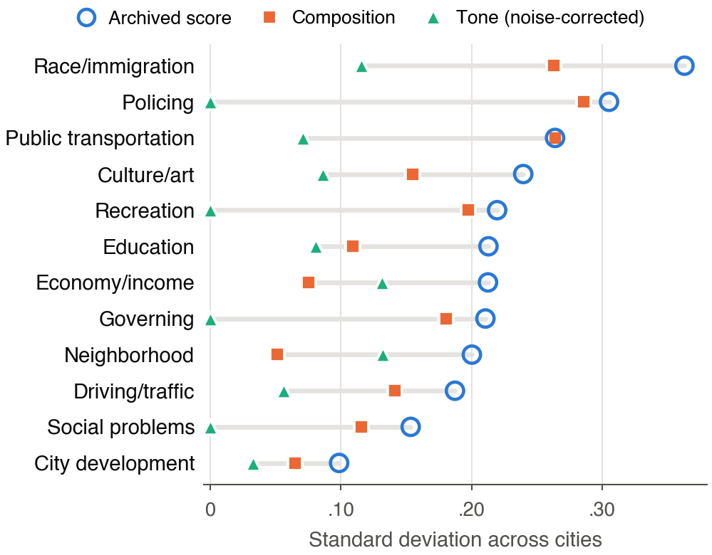

# Supplementary Material — Moved Figures, Tables, and Full Results

Companion index for *Connecting Online Opinions with Urban Statistics* (WWW '27 Short Papers). Every material moved out of the 4-page manuscript for space is presented here in full, alongside pointers to the exact CSVs and generation scripts.

---

## S1. Measurement Decomposition Across All 12 Domains *(Formerly Table 1 & Fig. 2)*

**Figure S1** *(vector PDF: [`figures/fig_sd_by_domain.pdf`](figures/fig_sd_by_domain.pdf), script: [`code/scripts/make_fig_sd.py`](code/scripts/make_fig_sd.py))*: City-to-city standard deviation of archived domain scores ($a_{ig}$, blue circles), included-keyword composition ($c_{ig}$, orange squares), and noise-corrected city tone ($\hat\alpha_{ig}$, green triangles) across all 12 domains.

**Table S1.** Per-domain counts, city coverage, noise-corrected dispersion, tone reliability $\rho_g$, REML boundary LRT $p_u$, and coverage–corpus-size correlations ($r(n, \log s)$). Values come directly from [`results/www_short/measurement/reliability_and_variance_shares.csv`](results/www_short/measurement/reliability_and_variance_shares.csv), [`results/www_short/measurement/random_effects_variance_components.csv`](results/www_short/measurement/random_effects_variance_components.csv), and [`results/www_short/diagnostics/coverage_size_and_vif.csv`](results/www_short/diagnostics/coverage_size_and_vif.csv).

| Domain | Keywords ($K_g$) | Cities | Med. $K$/city | $\mathrm{SD}(a)$ | $\mathrm{SD}(c)$ | $\mathrm{SD}(\hat\alpha)$ corr. | Reliability $\rho_g$ | REML $p_u$ | $r(n, \log s)$ |
|---|---:|---:|---:|---:|---:|---:|---:|---:|---:|
| Public Transportation | 22 | 37 | 5 | .26 | .26 | .07 | .28 | .02 | .80 |
| Driving and Traffic | 11 | 38 | 6 | .19 | .14 | .06 | .30 | .01 | .77 |
| Economy and Income | 13 | 37 | 4 | .21 | .08 | .13 | .46 | .06 | .89 |
| Education | 5 | 38 | 2 | .21 | .11 | .08 | .24 | .15 | .38 |
| Culture and Art | 6 | 37 | 3 | .24 | .15 | .09 | .33 | .04 | .53 |
| Race/Immigration Discourse | 13 | 23 | 2 | .36 | .26 | .12 | .23 | .19 | .70 |
| Recreation | 14 | 38 | 3.5 | .22 | .20 | .00 | −.35 | .26 | .55 |
| Social Problem | 19 | 35 | 2 | .15 | .12 | .00 | −.32 | .42 | .69 |
| Governing | 15 | 34 | 5 | .21 | .18 | .00 | −.42 | .50 | .84 |
| Policing | 8 | 36 | 2 | .31 | .29 | .00 | −.37 | .06 | .81 |
| Neighborhood | 5 | 38 | 5 | .20 | .05 | .13 | .50 | .00 | .77 |
| City Development | 12 | 38 | 7 | .10 | .06 | .03 | .12 | .34 | .90 |

Notes:
- Two listed keywords (`concert` in Culture and Art, `fraud` in Social Problem) have zero retained cells in the 38 sample cities, so observed keyword counts in regression cells are 6 and 19 (listed dictionary sizes are 7 and 20).
- Negative fixed-effects reliability $\rho_g$ occurs where the average city-effect sampling variance $\bar v_g$ exceeds the observed city variance of $\hat\alpha_{ig}$ (corrected $\mathrm{SD}(\hat\alpha)$ is floored at `.00`).
- Zero-effect Poisson retention simulations ($R = 500$ null worlds; [`results/www_short/diagnostics/null_simulation.csv`](results/www_short/diagnostics/null_simulation.csv)) show observed $r(n, \log s)$ falls below the null 5th percentile in eight domains (`Public Transportation`, `Education`, `Culture and Art`, `Race/Immigration Discourse`, `Recreation`, `Social Problem`, `Governing`, `Policing` — share of null runs $\le$ observed: `0.000`, `0.012`, `0.000`, `0.002`, `0.000`, `0.000`, `0.002`, `0.038`), near-boundary in `Driving and Traffic` (`0.080`), and inside the null support in `Economy and Income` (`0.282`), `Neighborhood` (`0.216`), and `City Development` (`0.430`).

---

## S2. Keyword Screening Protocol, Agreement, and the 20 Removed Terms *(Formerly Appendix A)*

Full written rules: [`data/keyword_screen_rules.md`](data/keyword_screen_rules.md). Complete 145-row double-coding and adjudication log: [`data/keyword_screen_codes.csv`](data/keyword_screen_codes.csv).

- **Inter-coder agreement:** 136 / 145 (93.8%), Cohen's $\kappa = 0.754$.
- **Adjudication:** 9 disagreements resolved jointly prior to running the screened confirmatory models; 20 keywords removed (125 kept). No domain exceeded its $\lfloor 0.30 K_g \rfloor$ removal cap.
- **Rules:** **R1** = city-specific proper name; **R2** = dominant city-subreddit sense is off-topic; **R3** = dominant sense belongs to another domain.

**Table S2.** All 20 keywords excluded in the screened analysis.

| Domain | Keyword | Rule | Coder A / B | Rationale |
|---|---|---:|---|---|
| Public Transportation | `dart rail` | R1 | drop / drop | Dallas DART light-rail proper name |
| Public Transportation | `mta` | R1 | drop / drop | Abbreviation for New York Metropolitan Transportation Authority |
| Public Transportation | `marta` | R1 | drop / drop | Atlanta transit system proper name |
| Public Transportation | `marta rail` | R1 | drop / drop | Same as above; Atlanta MARTA rail |
| Driving and Traffic | `direction` | R2 | drop / drop | Everyday expression (e.g., "right direction"), usually not driving directions |
| Economy and Income | `capital` | R2 | drop / drop | In subreddits like Austin, mostly refers to state capital rather than financial capital |
| Race/Immigration Discourse | `inequality` | R3 | drop / keep | adjudicated: Discussions mainly concern income and wealth disparities, falling under Economy and Income |
| Race/Immigration Discourse | `majority` | R2 | drop / drop | Everyday quantifier ("majority of"), rarely refers to a racial majority group |
| Recreation | `fan` | R2 | drop / drop | Colloquial expression (e.g., "not a fan of") in forum posts |
| Social Problem | `road rage` | R3 | drop / drop | Road rage belongs in Driving and Traffic |
| Social Problem | `weed` | R2 | drop / keep | adjudicated: Most retaining cities are legalized markets where forum threads center on casual consumption rather than a social problem |
| Social Problem | `police brutality` | R3 | drop / drop | Police brutality belongs primarily to Policing |
| Governing | `cuomo` | R1 | drop / drop | Surname of New York governor; state/city-specific proper name |
| Governing | `officers` | R3 | drop / drop | In US city subreddits, "officers" nearly always means police officers (Policing) |
| Governing | `property taxes` | R3 | drop / drop | Tax terms ("tax", "taxes") are in Economy and Income; property taxes belong there too |
| Governing | `taxation` | R3 | drop / drop | Same as above; taxation belongs in Economy and Income |
| Policing | `nypd` | R1 | drop / drop | Abbreviation for New York Police Department |
| Neighborhood | `resources` | R2 | drop / drop | Broadly refers to general resources or megathreads rather than neighborhoods |
| City Development | `planning` | R2 | keep / drop | adjudicated: Ambiguous participle/gerund; everyday "planning to visit/move" overwhelmingly dominates over urban planning in city threads |
| City Development | `city limits` | R2 | drop / drop | Refers merely to geographic municipal boundaries ("within city limits") rather than urban development |

---

## S3. RQ1 Simultaneous 12-Domain and Urban-Statistics Models of Composite $C$

Generated by [`code/scripts/make_tables.py`](code/scripts/make_tables.py) and [`code/scripts/derived_numbers.py`](code/scripts/derived_numbers.py) from [`results/www_short/confirmatory/two_sided_decomposition_C.csv`](results/www_short/confirmatory/two_sided_decomposition_C.csv), [`score_side_split.csv`](results/www_short/confirmatory/score_side_split.csv), [`score_side_split_RE_tone.csv`](results/www_short/confirmatory/score_side_split_RE_tone.csv), and [`screened_score_side_split.csv`](results/www_short/confirmatory/screened_score_side_split.csv).

**Table S3.** Standardized 12-domain OLS slopes for composite segregation $C$ across all imputation/decomposition designs and robustness variants. Minimum HC3 BH-adjusted $q$-value across 12 coefficients in $C$ models: `0.108` (main), `0.226` (screened), `0.854` (RE BLUP). Model $R^2$ (main): `0.545` (`a_zero_fill`), `0.573` (`a_mean_fill`), `0.116` (`composition_mean_fill`), `0.442` (`tone_mean_fill`).

| Domain | $a_0$ (orig.) | $b_U$ (pop. share) | $a_{\text{mean}}$ | Comp. $c$ | FE Tone $\hat\alpha$ | RE Tone | Screened $a_{\text{mean}}$ | Screened $c$ | Screened $\hat\alpha$ |
|---|---:|---:|---:|---:|---:|---:|---:|---:|---:|
| Public Transportation | −.324 | −.306 | −.335 | −.311 | .063 | −.045 | −.326 | −.249 | .054 |
| Driving and Traffic | −.374 | −.404 | −.306 | −.149 | .030 | .066 | −.375 | −.349 | .059 |
| Economy and Income | −.383 | −.461 | −.528 | −.060 | −.148 | −.158 | −.576 | −.118 | −.104 |
| Education | .054 | .182 | .004 | −.192 | −.015 | .054 | .097 | −.119 | −.008 |
| Culture and Art | .107 | .052 | .019 | −.043 | .077 | .104 | .043 | .118 | .111 |
| Race/Immigration Discourse | .119 | .153 | .049 | .085 | −.086 | −.107 | .027 | .124 | .043 |
| Recreation | .147 | .176 | .140 | −.033 | −.053 | −.057 | .229 | .193 | −.128 |
| Social Problem | −.421 | −.285 | −.432 | .019 | −.228 | −.200 | −.347 | −.053 | −.252 |
| Governing | −.374 | −.365 | −.306 | .206 | −.093 | −.109 | −.318 | .152 | −.054 |
| Policing | .087 | .098 | −.033 | −.042 | .390 | .301 | −.030 | −.048 | .427 |
| Neighborhood | −.186 | −.150 | −.250 | .075 | −.117 | −.179 | −.336 | .084 | −.119 |
| City Development | −.248 | −.268 | −.255 | −.249 | −.243 | −.216 | .042 | −.060 | −.183 |

**Table S4.** Outcome-side decomposition ($b_C = b_U + b_V + b_W$) of the archived 11-indicator urban-statistics model of $C$ ($R^2 = 0.805$; [`results/www_short/derived/admin_outcome_side_split.csv`](results/www_short/derived/admin_outcome_side_split.csv)). Across alternative outcomes, only `commute_%carpool` on $N$, $\bar D$, and $D_{BW}$ ($b = -0.539, -0.470, -0.635$, all $q \le .001$) and Hispanic–White income inequality on $D_{HW}$ ($b = -0.570, q = .003$) pass $q < .05$.

| Indicator | $b_C$ | $b_U$ (group share) | $b_V$ (normalized $N$) | $b_W$ (interaction) | HC3 $q_{BH}$ |
|---|---:|---:|---:|---:|---:|
| Urban land area (sq mi) | .581 | .361 | .185 | .036 | .048 |
| Urban population density | .617 | .449 | .084 | .084 | .093 |
| Poverty rate | .360 | .281 | .207 | −.127 | .299 |
| Median household income | .301 | .352 | .116 | −.167 | .330 |
| Carpool commute share | .131 | .309 | −.213 | .035 | .367 |
| Drive-alone commute share | .602 | .426 | .218 | −.042 | .088 |
| Homeownership rate | −.007 | −.073 | .064 | .002 | .973 |
| Black–White income inequality | .235 | .317 | −.096 | .014 | .310 |
| Hispanic–White income inequality | −.138 | −.166 | .043 | −.016 | .330 |
| Driving Score | −.276 | −.204 | −.073 | .001 | .299 |
| Walking Score | .367 | .271 | .099 | −.003 | .299 |

---

## S4. Complete 864-Model Single-Domain Grid

Full CSVs: [`single_domain_grid_864.csv`](results/www_short/confirmatory/single_domain_grid_864.csv), [`single_domain_grid_RE_tone.csv`](results/www_short/confirmatory/single_domain_grid_RE_tone.csv), and [`screened_single_domain_grid.csv`](results/www_short/confirmatory/screened_single_domain_grid.csv). Across 864 focal models organized into 72 twelve-domain families (4 signals $\times$ 3 control sets $\times$ 6 outcomes), **9** coefficients pass Benjamini–Hochberg $q < .05$ (1 each in 9 families), versus **4.19 to 5.52** families expected by chance under outcome permutation across cities ([`permutation_dry_run.csv`](results/www_short/diagnostics/permutation_dry_run.csv)):

| Outcome | Domain | Signal | Controls (+ $\log s$) | $\beta$ | HC3 $q_{BH}$ |
|---|---|---|---|---:|---:|
| $C$ (`archived_composite`) | Economy and Income | `a_available` | `none+log_s` | −0.532 | .040 |
| $N$ (`normalized_composite`) | Policing | `a_available` | `density_income+log_s` | 0.411 | .026 |
| $N$ (`normalized_composite`) | Social Problem | `a_zero_fill` | `none+log_s` | −0.493 | .005 |
| $\bar D$ (`equal_pairwise_mean`) | Social Problem | `a_zero_fill` | `none+log_s` | −0.452 | .013 |
| $N$ (`normalized_composite`) | Social Problem | `a_zero_fill` | `density_income+log_s` | −0.448 | .008 |
| $C$ (`archived_composite`) | Social Problem | `a_zero_fill` | `density_income_shares+log_s` | −0.115 | .004 |
| $N$ (`normalized_composite`) | Social Problem | `a_zero_fill` | `density_income_shares+log_s` | −0.414 | .004 |
| $C$ (`archived_composite`) | Economy and Income | `tone` | `none+log_s` | −0.512 | .014 |
| $C$ (`archived_composite`) | Governing | `tone` | `density_income+log_s` | −0.356 | .032 |

Note that `Governing` has negative estimated tone reliability ($\rho_g = -0.42$). Under REML BLUP substitution and under the 125-keyword screen, neither transport domain yields any $q < .05$ hit.

---

## S5. RQ2 Partial Correlations Controlling for $\log s_i$ and $\log(\text{pop}_i)$

Full tables: [`rq2_partial_correlations.csv`](results/www_short/confirmatory/rq2_partial_correlations.csv), [`screened_rq2_partial_correlations.csv`](results/www_short/confirmatory/screened_rq2_partial_correlations.csv), [`rq2_original_four_pairs.csv`](results/www_short/confirmatory/rq2_original_four_pairs.csv), and [`rq2_exploratory_transport.csv`](results/www_short/confirmatory/rq2_exploratory_transport.csv).

**Original four BH-significant raw pairs** re-tested after controlling for $\log s_i$ and $\log(\text{pop}_i)$:
- `Neighborhood` $\times$ Drive-alone commute (Pearson): raw $r = +.551$; coverage $r_p = -.039$ ($q = .879$), tone $r_p = +.331$ ($q = .416$).
- `Recreation` $\times$ Driving Score (Pearson): raw $r = +.540$; coverage $r_p = -.073$ ($q = .801$), tone $r_p = +.040$ ($q = .966$).
- `Economy and Income` $\times$ Drive-alone commute (Spearman): raw $r = +.606$; coverage $r_p = -.158$ ($q = .605$), tone $r_p = +.388$ ($q = .259$).
- `Education` $\times$ Black–White income inequality (Spearman): raw $r = +.572$; coverage $r_p = +.049$ ($q = .903$), tone $r_p = +.595$ ($q = .017$).

**All BH hits ($q < .05$) across 132-test families (main: 6 total; screened: 13 total):**
- Main: Tone Spearman — Education $\times$ Black–White inequality ($r_p = +.595, q = .017$), Neighborhood $\times$ Walking Score ($r_p = -.553, q = .031$); Coverage Pearson — Economy and Income $\times$ Walking Score ($+.575, .032$), Governing $\times$ Walking Score ($+.536, .050$); Coverage Spearman — Social Problem $\times$ Urban land area ($-.567, .021$), Social Problem $\times$ Walking Score ($+.580, .021$).
- Screened: adds Coverage links for Economy/Governing/Race-Immigration with drive-alone share ($r_p \in [-.570, -.503], q \le .047$) and density/Walking Score ($+.508$ to $+.597, q \le .035$).

**Exploratory 16-test transport family** (`Transit Score` and `commute_%public transit`):

| Domain | Signal | Method | Indicator | $r_{\text{partial}}$ | $q_{BH}$ |
|---|---|---|---|---:|---:|
| Public Transportation | tone | Pearson / Spearman | Transit Score | −.175 / −.187 | .447 / .447 |
| Public Transportation | tone | Pearson / Spearman | Transit commute share | −.168 / −.383 | .447 / .074 |
| Driving and Traffic | tone | Pearson / Spearman | Transit Score | −.284 / −.308 | .197 / .182 |
| Driving and Traffic | tone | Pearson / Spearman | Transit commute share | −.280 / −.251 | .197 / .248 |
| Public Transportation | coverage $n$ | Pearson / Spearman | Transit Score | .048 / −.064 | .780 / .757 |
| Public Transportation | coverage $n$ | Pearson / Spearman | Transit commute share | .117 / −.098 | .613 / .653 |
| Driving and Traffic | coverage $n$ | Pearson / Spearman | Transit Score | **−.528** / **−.418** | **.015** / **.045** |
| Driving and Traffic | coverage $n$ | Pearson / Spearman | Transit commute share | **−.471** / **−.498** | **.020** / **.016** |

---

## S6. Bootstrap, Leave-One-Out, and Rank Sensitivity Summaries

**Table S5.** End-to-end 38-city bootstrap ($B = 2000$ valid resamples; [`bootstrap_delta.csv`](results/www_short/confirmatory/bootstrap_delta.csv)) for $\Delta = b(a) - b(\hat\alpha)$ on composite $C$.

| Model | $\Delta_{\text{point}}$ | 2.5% | 97.5% | Valid resamples |
|---|---:|---:|---:|---:|
| 12-domain \| Public Transportation | −.398 | −.935 | +.128 | 2000 |
| Single-domain \| Public Transportation \| `none + log s` | −.198 | −.563 | +.239 | 2000 |
| Single-domain \| Public Transportation \| `density_income + log s` | −.373 | −.672 | −.002 | 2000 |
| Single-domain \| Public Transportation \| `density_income_shares + log s` | −.013 | −.115 | +.095 | 2000 |
| 12-domain \| Driving and Traffic | −.336 | −.830 | +.075 | 2000 |
| Single-domain \| Driving and Traffic \| `none + log s` | −.019 | −.334 | +.252 | 2000 |
| Single-domain \| Driving and Traffic \| `density_income + log s` | +.034 | −.218 | +.268 | 2000 |
| Single-domain \| Driving and Traffic \| `density_income_shares + log s` | +.018 | −.062 | +.094 | 2000 |

Full leave-one-city-out ([`leave_one_city_out.csv`](results/www_short/confirmatory/leave_one_city_out.csv)), leave-one-keyword-out ([`leave_one_keyword_out_summary.csv`](results/www_short/confirmatory/leave_one_keyword_out_summary.csv)), and rank-transformed transport estimates ([`rank_versions.csv`](results/www_short/confirmatory/rank_versions.csv)) reproduce in Section 7.6 of [`code/www_short_analysis.ipynb`](code/www_short_analysis.ipynb).
